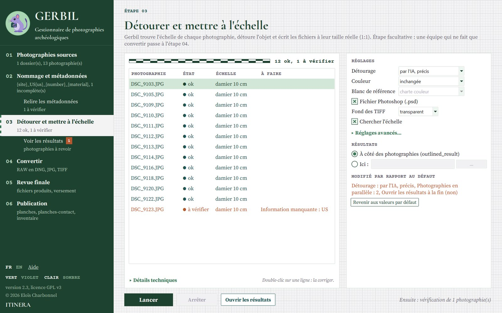
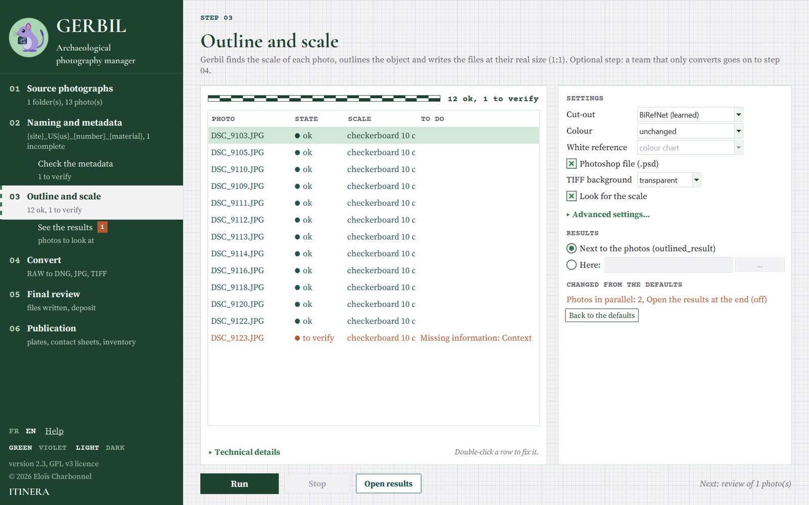

  

<h1 align="center">Gerbil</h1>

  <em>Gestionnaire de photographies archéologiques</em> 
  <em>Archaeological photo manager</em>

  <a href="https://github.com/EloisCharbonnel/gerbil/releases/latest"><strong>Télécharger pour Windows</strong></a>
  &nbsp; | &nbsp;
  <a href="#english"><strong>English below</strong></a>

---

## Français

Vous cherchez un outil de gestion des photographies archéologiques ? **Gerbil détoure chaque objet, lit l'échelle
et livre des fichiers à taille réelle**, prêts à poser dans Illustrator pour vos planches. Il nomme et documente
vos photographies, convertit vos RAW pour l'archive, compose les planches et prépare le versement. Une série de
plusieurs centaines de photographies se traite en un seul clic, et chaque résultat reste modifiable.

  

### Ce que fait Gerbil

- **Détourage** : l'objet est séparé du fond, de son ombre portée, des étiquettes et de l'échelle. Par défaut,
  c'est **BiRefNet**, un algorithme d'apprentissage automatique, qui désigne les objets : il reste sûr avec une
  ombre portée, le bord de la table ou un objet blanc sur fond blanc. Un détourage plus rapide, par la couleur,
  reste au choix.
- **Taille réelle** : l'échelle (damier de 1 cm ou réglet millimétré, de 5 ou 10 cm, ou une échelle que vous lui
  apprenez) est mesurée automatiquement. Glissé dans Illustrator, l'objet apparaît au 1:1.
- **Nommage et métadonnées** : les fichiers produits prennent un nom construit à partir de vos champs (site,
  secteur, US, numéro d'inventaire, matière…), sans accents si vous le souhaitez, et ces informations sont
  inscrites dans les fichiers (IPTC). Vos photographies d'origine ne sont jamais modifiées ni renommées.
- **Vérification** : les cas douteux sont signalés en premier. Vous les corrigez au pinceau, au lasso ou d'un
  simple clic sur l'objet.
- **Conversion des RAW en DNG** pour l'archive, avec leurs métadonnées, un JPG et, si vous le souhaitez, un TIFF
  16 bits.
- **Publication** : planches à l'échelle choisie (1:1, 1:2, 1:3…), avec vos dessins et une barre d'échelle ;
  planches libres de photographies de terrain ou d'orthophotos à une échelle commune ; planches-contact ;
  inventaire au format tableur ; vignettes.
- **Versement** : un contrôle du dossier avant sa remise aux archives (formats, noms, doublons, sommes de
  contrôle).
- **Profils de site** à partager avec l'équipe : champs, modèle de nom, mots-clés, réglages.
- **Tout reste sur votre ordinateur** : aucune photographie n'est envoyée sur Internet.

### Installer

1. Téléchargez **`Gerbil_Setup.exe`** depuis la
   [dernière version](https://github.com/EloisCharbonnel/gerbil/releases/latest) (Windows 10 ou 11).
2. Double-cliquez dessus. L'installation ne demande **ni droits d'administrateur ni Python** : elle fonctionne
   aussi sur un poste de travail verrouillé.
3. Le programme n'étant pas signé, Windows peut afficher « Windows a protégé votre ordinateur ». Cliquez sur
   *Informations complémentaires*, puis sur *Exécuter quand même*.

Gerbil apparaît ensuite dans le menu Démarrer. L'interface existe en français et en anglais, en vert ou en
violet, claire ou sombre.

### Démarrer

La fenêtre suit les six étapes du travail, dans la colonne de gauche :

1. **Photographies sources** : ajoutez le dossier de vos photographies et choisissez le profil du site.
2. **Nommage et métadonnées** (facultatif) : décrivez vos objets, la photographie affichée en grand pour les
   reconnaître, et choisissez le nom des fichiers ; puis relisez les métadonnées.
3. **Détourer et mettre à l'échelle** : cliquez sur *Lancer*, puis reprenez les photographies signalées.
4. **Convertir** : vos RAW en DNG, avec leurs métadonnées (et un JPG ou un TIFF si vous le souhaitez).
5. **Revue finale** : les fichiers produits, et le contrôle avant versement.
6. **Publication** : composez vos planches, votre inventaire et vos vignettes.

Les résultats sont rangés dans un dossier `outlined_result`, à côté de vos photographies. Pour chaque
photographie, vous obtenez :

- un fichier Photoshop à calques (objet, échelle, photographie d'origine) ;
- l'objet détouré, sur fond transparent, à taille réelle ;
- l'objet avec son échelle ;
- un aperçu de contrôle et une ligne dans le rapport (tableur).

### Pour de bons résultats

- Un **fond uni**, clair ou en velours noir.
- L'**échelle à la même hauteur que l'objet**, sinon la mesure est fausse.
- L'**objet entier dans le cadre**, l'appareil parallèle à la table.

Les dimensions données par Gerbil servent à la mise en page : ce ne sont pas des mesures scientifiques.

### Aide

- Le **guide de l'utilisateur en français** (PDF), avec des captures sur un vrai lot de tessons, accompagne
  chaque [version](https://github.com/EloisCharbonnel/gerbil/releases/latest) ; le bouton *Aide* du programme
  l'ouvre aussi. Un **guide du code** est dans le dossier [`docs`](docs).
- Un problème, une idée ? Ouvrez un [ticket](https://github.com/EloisCharbonnel/gerbil/issues) (compte GitHub
  gratuit). Ne joignez que des photographies que vous avez le droit de partager.

---

## English

Looking for a tool to manage your archaeological photos? **Gerbil cuts out each object, reads the scale and
delivers files at their real size**, ready to drop into Illustrator for your plates. It names and documents
your photos, converts your RAW photos for the archive, lays out the plates and prepares the deposit. A series of
several hundred photos is processed in one click, and every result stays editable.

  

### What Gerbil does

- **Cut-out**: the object is separated from the background, its cast shadow, labels and the scale. By default,
  **BiRefNet**, an algorithm of machine learning, points out the objects: it stays sure with a cast shadow, the
  edge of the table or a white object on white. A faster cut-out, by the colour, remains available.
- **Real size**: the scale (1 cm checkerboard or millimetre ruler, 5 or 10 cm long, or a scale you teach it) is
  measured automatically. Dropped into Illustrator, the object shows at 1:1.
- **Naming and metadata**: output files take a name built from your fields (site, sector, context, inventory
  number, material…), without accents if you wish, and this information is written into the files (IPTC). Your
  original photos are never changed or renamed.
- **Review**: doubtful cases come first. Fix them with a brush, a lasso or a single click on the object.
- **RAW to DNG conversion** for the archive, with their metadata, a JPG and, if wanted, a 16-bit TIFF.
- **Publication**: plates at the scale you choose (1:1, 1:2, 1:3…), with your drawings and a scale bar; free
  plates of field photos or orthophotos at a common scale; contact sheets; a spreadsheet inventory; thumbnails.
- **Deposit**: a check of the folder before it goes to an archive (formats, names, duplicates, checksums).
- **Site profiles** to share with the team: fields, name template, keywords, settings.
- **Everything stays on your computer**: no photo is sent over the internet.

### Install

1. Download **`Gerbil_Setup.exe`** from the
   [latest release](https://github.com/EloisCharbonnel/gerbil/releases/latest) (Windows 10 or 11).
2. Double-click it. It needs **no administrator rights and no Python**, so it also works on a locked-down work
   computer.
3. The program is not signed, so Windows may show "Windows protected your PC". Click *More info*, then
   *Run anyway*.

Gerbil then appears in the Start menu. The interface is in French and English, green or violet, light or dark.

### Getting started

The window follows the six steps of the work, in the left column:

1. **Source photographs**: add the folder of your photos and choose the site profile.
2. **Naming and metadata** (optional): describe your objects, with the photo shown in large to recognise them,
   and choose the file names; then check the metadata.
3. **Outline and scale**: click *Run*, then go over the flagged photos.
4. **Convert**: your RAW photos to DNG, with their metadata (and a JPG or a TIFF if wanted).
5. **Final review**: the files written, and the check before a deposit.
6. **Publication**: make your plates, inventory and thumbnails.

The results go into an `outlined_result` folder next to your photos. For each photo you get:

- a layered Photoshop file (object, scale, original photo);
- the cut-out object on a transparent background, at real size;
- the object with its scale;
- a control preview and a row in the report (spreadsheet).

### For good results

- A **plain background**, light or black velvet.
- The **scale at the same height as the object**, or the measurement is wrong.
- The **whole object in the frame**, the camera parallel to the table.

The sizes Gerbil gives are layout aids, not scientific measurements.

### Help

- The **user guide in English** (PDF), with screenshots of a real set of sherds, comes with each
  [release](https://github.com/EloisCharbonnel/gerbil/releases/latest); the *Help* button of the program opens
  it too. A **guide to the code** is in the [`docs`](docs) folder.
- A problem or an idea? Open an [issue](https://github.com/EloisCharbonnel/gerbil/issues) (free GitHub
  account). Only attach photos you have the right to share.

---

  © 2026 Eloïs Charbonnel, ITINERA 
  Free software under the <a href="LICENSE">GNU GPL v3</a>
  &nbsp; | &nbsp; <a href="docs/MANUAL.md">Reference manual</a>
  &nbsp; | &nbsp; <a href="CONTRIBUTING.md">Contributing</a>

